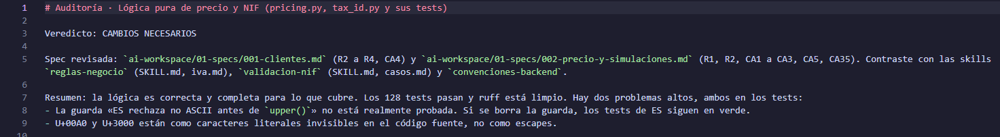
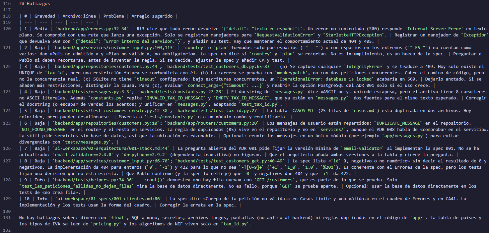
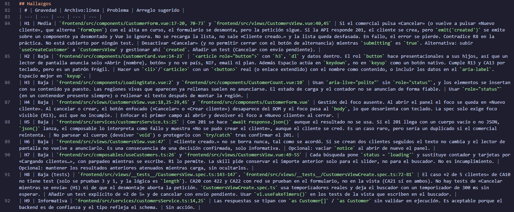
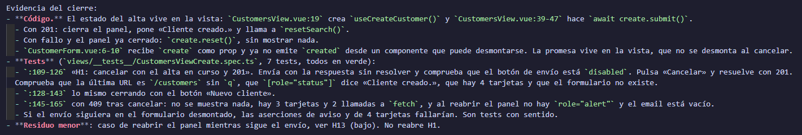
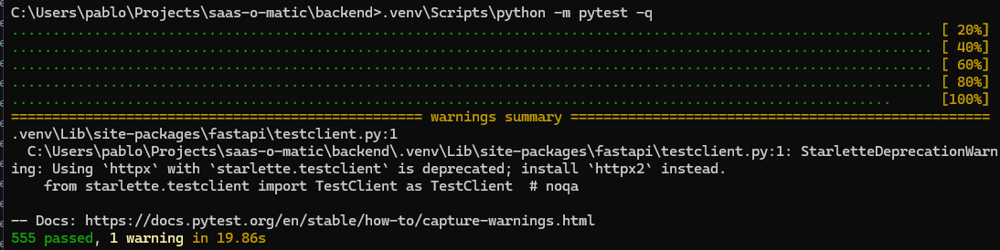
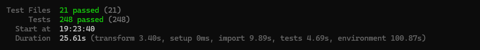
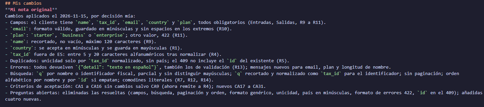

# Capturas del proceso

Siete capturas de momentos concretos del desarrollo. Las auditorías y las specs completas están en sus carpetas; aquí está lo que más cuenta del control de calidad.

## 1. Una auditoría que pidió cambios

El auditor revisó la lógica de precios y de validación de NIF antes de que se construyera nada encima. Su veredicto fue **CAMBIOS NECESARIOS**: los 128 tests pasaban y ruff estaba limpio, pero había dos problemas altos en los tests. Una guarda (rechazar caracteres no ASCII antes de pasar a mayúsculas) no estaba realmente probada: si se borraba, los tests seguían en verde. Y había caracteres invisibles escritos tal cual en el código. Que pasen los tests no basta si no prueban lo que dicen probar. Se corrigió y la [auditoría 002](../auditorias/002-logica-pura-reauditoria.md) lo aprobó.

## 2. Un error 500 en texto plano

La spec decía que todo error de la API devuelve `{"detail": "texto en español"}`. El auditor lo probó con una ruta que lanza una excepción y comprobó que un error no controlado respondía `Internal Server Error` en texto plano. Se registró un manejador general y la [auditoría 004](../auditorias/004-api-simulaciones.md) ya lo da por cumplido, incluido el 500.

## 3. Una condición de carrera en el frontend

Si el comercial pulsaba «Cancelar» con el alta de un cliente en curso, el formulario se desmontaba pero la petición seguía: el cliente se creaba y la lista quedaba desfasada, sin mensaje. Ningún test lo cubría. Es el tipo de fallo que no se ve usando la aplicación con calma.

La corrección movió el estado del alta a la vista, que no se desmonta al cancelar, y añadió tests para ese caso. La [auditoría 006](../auditorias/006-frontend-simulador.md) lo comprobó.

## 4. Los tests

Estado final: 555 tests en el backend (pytest) y 248 en el frontend (Vitest, 21 archivos).

## 5. Mis cambios en una spec

Cada spec que redactaba el arquitecto pasaba por mí antes de aprobarse, y lo que cambiaba lo anotaba en «Mis cambios». Aquí, la primera ronda de la spec de clientes: campos obligatorios, formato del email, validación del NIF fuera de España, qué es un duplicado, formato de los errores y cómo funciona la búsqueda.